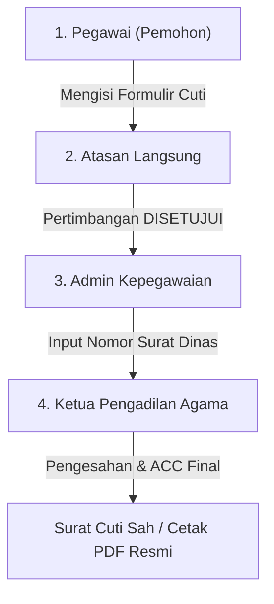
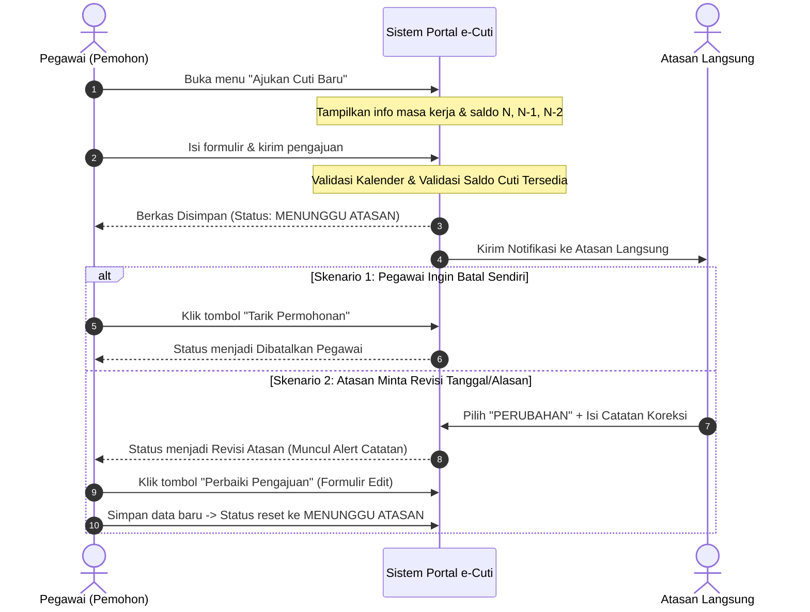
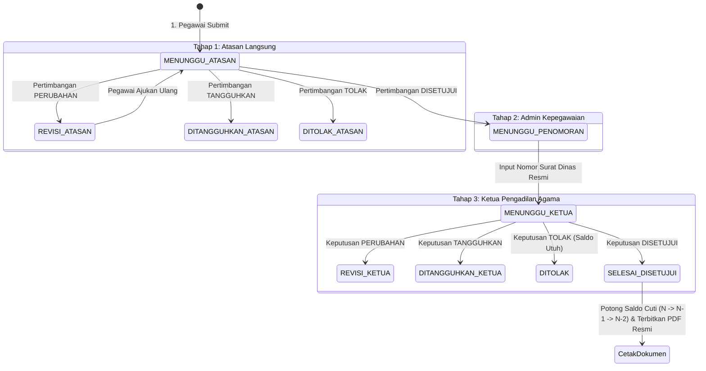

# Alur Keseluruhan Sistem Portal e-Cuti Pengadilan Agama Sumber

> **Catatan Pengantar Dokumen:**  
> Dokumen ini disusun sebagai draf resmi **Alur Keseluruhan Sistem (*System Flow*)** pada aplikasi **Portal e-Cuti (Sistem Informasi Kepegawaian)** di lingkungan **Pengadilan Agama Sumber Kelas IA**. Dokumen ini merangkum seluruh logika bisnis, hierarki otorisasi, tahapan persetujuan cuti berjenjang, serta hak akses tampilan yang telah diimplementasikan dalam kode sumber. Draf ini ditujukan sebagai bahan konfirmasi alur bisnis, standarisasi operasional, dan materi presentasi kepada pimpinan serta pihak terkait di Pengadilan Agama Sumber.

---

---

## 1. Daftar Role dan Jabatan Sistem

Sistem membagi pengguna ke dalam **4 Aktor Utama** berdasarkan kombinasi hak akses sistem (*role*) dan kedudukan struktural kepegawaian (*jabatan* serta relasi *atasan langsung*):

### 1.1. Pegawai (Aparatur Pemohon Cuti)
* **Kategori Akun**: Pengguna dengan peran bawaan **`Pegawai`** (`role: pegawai`).
* **Karakteristik Kepegawaian**: Seluruh ASN / Aparatur Sipil Negara yang terdaftar dengan atribut NIP, Jabatan Resmi, Unit Kerja, TMT/Masa Kerja, serta jatah kuota cuti tahunan 3 tahun berturut-turut (**Tahun N**, **Tahun N-1**, dan **Tahun N-2**).
* **Tugas & Batas Wewenang**:
  * Mengajukan permohonan cuti baru secara digital.
  * Memantau perkembangan status permohonan secara mandiri di halaman **Riwayat Pengajuan**.
  * Membatalkan permohonan melalui fitur **Tarik Permohonan** selama berkas belum disahkan.
  * Memperbarui data pengajuan melalui fitur **Perbaiki Pengajuan** jika ada catatan koreksi dari atasan.
  * Mengunduh dan mencetak dokumen pada tombol **Cetak PDF Formulir Resmi** jika permohonan telah berstatus **Disetujui**.

### 1.2. Atasan Langsung (Pejabat Pemberi Pertimbangan Tahap 1)
* **Kategori Akun**: Ditentukan secara **dinamis** berdasarkan struktur hierarki kepegawaian (setiap pegawai yang ID-nya tercatat sebagai `atasan_langsung_id` bagi pegawai lain).
* **Contoh Pejabat Riil**: **Panitera Muda**, **Kepala Sub Bagian (Kasubbag)**, **Panitera**, **Sekretaris**, atau **Wakil Ketua**.
* **Tugas & Batas Wewenang**:
  * Menerima notifikasi (*in-app* dan *web push*) saat staf bawahannya mengirimkan permohonan cuti.
  * Memeriksa alasan cuti, durasi hari kerja, serta ketersediaan personil kerja di unit yang dipimpinnya melalui menu **Persetujuan Cuti Bawahan**.
  * Memberikan salah satu dari 4 opsi pertimbangan awal: **Disetujui**, **Perubahan (Revisi)**, **Ditangguhkan**, atau **Ditolak**.

### 1.3. Admin Kepegawaian (Pengelola Administrasi & Tata Laksana)
* **Kategori Akun**: Pengguna dengan peran administratif penuh **`Admin`** (`role: admin`), umumnya dipegang oleh **Kasubbag Kepegawaian & Tata Laksana (Ortala)** atau Staf Pengelola SIMPEG.
* **Tugas & Batas Wewenang**:
  * Menerima antrean berkas cuti yang telah lolos pertimbangan atasan langsung pada halaman **Penomoran Surat Cuti**.
  * Mengalokasikan dan menginputkan **Nomor Surat Dinas Resmi** (contoh: `W10-A21/123/KP.05.2/X/2026`) yang tervalidasi unik (anti-duplikasi).
  * Mengelola *master data* seluruh aparatur melalui menu **Data Pegawai & Akun** (menambah pegawai baru, mengubah data NIP, jabatan, unit kerja, tanggal masuk/TMT, memetakan atasan langsung, dan memperbarui alokasi saldo cuti).

### 1.4. Ketua Pengadilan Agama (Pejabat Pembina Kepegawaian / Pengesah Final)
* **Kategori Akun**: Pejabat tertinggi dengan penanda jabatan spesifik **`Ketua PA`** (`jabatan: Ketua PA`).
* **Tugas & Batas Wewenang**:
  * Memegang kewenangan hukum tertinggi selaku Pejabat Pembina Kepegawaian (PPK).
  * Memeriksa berkas permohonan yang telah lengkap (sudah disetujui atasan dan sudah bernomor surat dinas) melalui menu **Keputusan Final Ketua**.
  * Memberikan keputusan akhir: **Disetujui**, **Perubahan**, **Ditangguhkan**, atau **Ditolak**.
  * Keputusan **Disetujui** oleh **Ketua Pengadilan Agama** secara otomatis memotong saldo cuti tahunan pegawai pemohon dan mengesahkan dokumen cuti resmi.

---

## 2. Alur Pengajuan Cuti oleh Pegawai (*User Journey*)

Langkah-langkah yang dilalui oleh seorang **Pegawai** mulai dari pengisian data hingga status pengajuan:

### Langkah demi Langkah:

1. **Akses Formulir & Pengecekan Kuota Mandiri**:
   * Pegawai membuka menu **Ajukan Cuti Baru** (`/cuti/ajukan`).
   * Halaman menampilkan ringkasan profil pemohon serta kartu **Informasi Kuota Cuti Tahunan**:
     * **Tahun Berjalan (N)**: Hak cuti tahun berjalan (standar 12 hari kerja).
     * **Tahun Lalu (N-1)**: Sisa cuti tahun sebelumnya yang belum gugur.
     * **Dua Tahun Lalu (N-2)**: Sisa akumulasi cuti 2 tahun lalu.
2. **Pengisian Rincian Permohonan Cuti**:
   * **Jenis Cuti**: Memilih salah satu dari 6 jenis cuti ASN (*Cuti Tahunan, Cuti Besar, Cuti Sakit, Cuti Melahirkan, Cuti Karena Alasan Penting, atau Cuti di Luar Tanggungan Negara*).
   * **Alasan Cuti**: Keterangan keperluan permohonan.
   * **Tanggal & Durasi**: Menentukan tanggal mulai, tanggal selesai, dan jumlah durasi hari kerja.
   * **Alamat & Kontak**: Menginputkan alamat lengkap selama masa cuti dan nomor telepon/WhatsApp yang aktif dapat dihubungi.
3. **Penyaringan & Validasi Sistem Real-Time**:
   * **Validasi Rentang Kalender**: Durasi hari kerja yang diinputkan tidak boleh lebih besar dari total hari kalender antara tanggal mulai dan tanggal selesai.
   * **Validasi Kecukupan Kuota**: Khusus permohonan **Cuti Tahunan**, sistem menjumlahkan total saldo yang tersedia $(N + N-1 + N-2)$. Jika durasi yang diminta melebihi total saldo, formulir akan otomatis ditolak oleh sistem sebelum tersimpan ke database.
4. **Penerbitan Status Berkas Awal**:
   * Berkas tersimpan dengan status **`MENUNGGU_ATASAN`** (**Menunggu Atasan**).
   * Sistem otomatis mengirimkan notifikasi *in-app* dan *web push* ke perangkat milik **Atasan Langsung**.
   * *Catatan Keamanan Saldo*: Pada tahap ini, **saldo cuti pegawai belum dipotong**, menjaga keadilan hak cuti pegawai selama masa tunggu pertimbangan.
5. **Aksi Fleksibel Pemohon di Halaman Riwayat Pengajuan**:
   * **Opsi Tarik Permohonan (Batal Mandiri)**: Selama berkas masih berstatus **Menunggu Atasan** atau **Revisi Atasan**, pegawai memiliki kendali penuh untuk membatalkan pengajuannya dengan menekan tombol **"Tarik Permohonan"**. Berkas berubah status menjadi **`Dibatalkan Pegawai`**.
   * **Opsi Perbaiki Pengajuan (Revisi Mandiri)**: Jika atasan memberikan catatan koreksi, berkas berubah status menjadi **`REVISI_ATASAN`** (**Revisi Atasan**). Di halaman perbaikan (`/cuti/{id}/edit`), sistem menampilkan kotak peringatan berisi rincian catatan koreksi atasan. Pegawai cukup mengubah rincian yang keliru dan mengeklik **"Simpan Pembaruan & Ajukan Ulang"**, sehingga status berkas kembali menjadi **`MENUNGGU_ATASAN`**.

---

## 3. Hierarki Persetujuan Cuti Berjenjang (*Approval Pipeline*)

Proses persetujuan permohonan cuti menerapkan alur **3 Tahap Berjenjang yang Mengikat (*Enforced 3-Stage Pipeline*)** yang tidak dapat dilompati (*anti-bypass*):

---

### 3.1. Tahap 1: Verifikasi & Pertimbangan oleh Atasan Langsung
* **Halaman Kerja**: Menu **Persetujuan Cuti Bawahan** (`/cuti/persetujuan`).
* **Proteksi Akses**: Hanya atasan langsung yang terhubung di tabel kepegawaian yang diizinkan membuka formulir pertimbangan (`/cuti/persetujuan/{id}`).
* **4 Pilihan Pertimbangan Atasan**:
  1. **DISETUJUI**: Berkas dinyatakan memenuhi syarat. Status berkas berubah menjadi **`MENUNGGU_PENOMORAN`** (**Menunggu Penomoran**). Notifikasi diteruskan ke **Admin Kepegawaian**.
     * *Integritas Data Historis*: ID akun Atasan yang menyetujui dicatat secara permanen ke dalam kolom snapshot **`disetujui_oleh_atasan_id`** agar jejak riwayat tidak terpengaruh jika terjadi mutasi atasan di kemudian hari.
  2. **PERUBAHAN**: Atasan mewajibkan perbaikan dengan menyertakan catatan tertulis. Status berkas menjadi **`REVISI_ATASAN`** (**Revisi Atasan**).
  3. **DITANGGUHKAN**: Pelaksanaan cuti ditunda sementara waktu karena beban kerja kantor. Status berkas menjadi **`DITANGGUHKAN_ATASAN`**.
  4. **DITOLAK**: Permohonan tidak dapat direkomendasikan. Status berkas menjadi **`DITOLAK_ATASAN`**.

---

### 3.2. Tahap 2: Registrasi Nomor Surat Dinas oleh Admin Kepegawaian
* **Halaman Kerja**: Menu **Penomoran Surat Cuti** (`/cuti/penomoran`).
* **Proteksi Akses**: Terbatas hanya untuk pengguna dengan kewenangan **`Admin`** (`role: admin`).
* **Tindakan Admin**:
  * Membuka permohonan berstatus **Menunggu Penomoran**.
  * Memasukkan nomor surat resmi instansi berdasarkan buku agenda persuratan Pengadilan Agama Sumber (contoh: `W10-A21/450/KP.05.2/X/2026`).
  * Sistem memvalidasi agar nomor surat bersifat unik dan belum pernah digunakan sebelumnya.
* **Hasil Tahap 2**:
  * Nomor surat dinas tersimpan ke dalam berkas.
  * Status berkas beralih menjadi **`MENUNGGU_KETUA`** (**Menunggu Keputusan Ketua**).
  * Notifikasi otomatis terkirim langsung ke akun **Ketua Pengadilan Agama**.

---

### 3.3. Tahap 3: Keputusan Pengesahan Final oleh Ketua Pengadilan Agama
* **Halaman Kerja**: Menu **Keputusan Final Ketua** (`/cuti/keputusan-ketua`).
* **Proteksi Akses**: Terbatas hanya untuk pejabat dengan jabatan **`Ketua PA`**.
* **Pertimbangan Pimpinan**:
  * Ketua memeriksa seluruh riwayat berkas: rincian izin permohonan pegawai, catatan pertimbangan tertulis atasan langsung, dan nomor dinas yang telah disiapkan kepegawaian.
* **4 Pilihan Putusan Final**:
  1. **DISETUJUI (ACC Final & Pengesahan Dokumen)**:
     * **Perekaman Snapshot Pejabat Pengesah**: ID Ketua yang mengesahkan dicatat permanen ke dalam kolom **`disahkan_oleh_ketua_id`** (Historical Data Integrity).
     * **Pemotongan Saldo Cuti Bertingkat (*Cascading Quota Deduction*)**:
       Khusus permohonan **Cuti Tahunan**, sistem mengeksekusi pemotongan saldo kuota cuti dengan algoritma bertingkat yang terlindungi transaksi database (*lockForUpdate*):
       1. Mengurangi saldo **Tahun N** (Tahun Berjalan) terlebih dahulu.
       2. Jika saldo $N$ tidak mencukupi, sisa hari diambil dari saldo **Tahun N-1** (Tahun Lalu).
       3. Jika masih terdapat sisa hari, diambil dari saldo **Tahun N-2** (Dua Tahun Lalu).
       *Jaminan Sistem*: Saldo cuti aparatur dijamin tidak akan pernah bernilai negatif dan tidak terjadi pemotongan ganda (*double-deduction*).
     * **Pembaruan Status**: Status berkas final menjadi **`SELESAI_DISETUJUI`** (tampil sebagai **Disetujui**).
     * **Penerbitan Notifikasi & Dokumen**: Pemohon menerima pemberitahuan resmi bahwa cuti telah disahkan dan tombol **Cetak PDF Formulir Resmi** aktif.
  2. **PERUBAHAN**: Berkas dikembalikan dengan catatan langsung dari Ketua PA (status menjadi **`REVISI_KETUA`**).
  3. **DITANGGUHKAN**: Berkas ditunda oleh Ketua PA (status menjadi **`DITANGGUHKAN_KETUA`**).
  4. **DITOLAK**: Permohonan ditolak final (status menjadi **`DITOLAK`**). **Saldo cuti pegawai tetap utuh (tidak terpotong)**.

---

### 3.4. Tahap Pasca-Persetujuan: Cetak Dokumen PDF Format Standar Mahkamah Agung RI
* Tombol **Cetak PDF Formulir Resmi** (`/cuti/cetak/{id}`) dapat diakses oleh pemohon maupun admin setelah status mencapai **Disetujui**.
* Dokumen PDF yang dihasilkan telah disesuaikan dengan blanko baku **Badan Kepegawaian Negara (BKN) & Surat Edaran Mahkamah Agung RI**:
  * Bagian I: Data Identitas Pegawai (Nama, NIP, Jabatan, Masa Kerja, Unit Kerja).
  * Bagian II: Jenis Cuti yang Diambil.
  * Bagian III: Alasan dan Durasi Cuti (Tanggal Mulai s.d. Selesai).
  * Bagian IV: Catatan Saldo Cuti 3 Tahun Terakhir ($N, N-1, N-2$).
  * Bagian V: Alamat Selama Menjalankan Cuti dan Nomor Telepon.
  * Bagian VI: Lembar Pertimbangan Atasan Langsung (Status, Catatan, Nama & NIP Atasan Penyetuju).
  * Bagian VII: Lembar Keputusan Pejabat yang Berwenang Memberikan Cuti (Nomor Surat Dinas, Tanggal Pengesahan, Nama & NIP Ketua Pengesah).
* **Jaminan Integritas Pejabat Penandatangan**: Data penandatangan pada cetakan PDF diambil langsung dari relasi transaksi snapshot (**`atasan_penyetuju`** dan **`ketua_pengesah`**), bukan dari relasi master pegawai yang dinamis. Dengan demikian, jika terjadi mutasi atasan atau pergantian Ketua PA di masa mendatang, dokumen fisik PDF permohonan masa lalu tetap sah dan tidak mengalami perubahan nama pejabat.

---

## 4. Matriks Hak Akses dan Tampilan Dashboard

Dashboard portal dirancang adaptif, menampilkan statistik, kartu saldo, dan tombol tugas yang disesuaikan secara dinamis berdasarkan aktor yang sedang masuk:

| Fitur / Halaman / Widget | 1. Pegawai Biasa | 2. Atasan Langsung | 3. Admin Kepegawaian | 4. Ketua PA |
| :--- | :---: | :---: | :---: | :---: |
| **Kartu Hero Profil & Masa Kerja Otomatis** | **Ya** (Data Diri) | **Ya** (Data Diri) | **Ya** (Data Diri) | **Ya** (Data Diri) |
| **Informasi Saldo Cuti 3 Tahun (N, N-1, N-2)** | **Ya** (Milik Sendiri) | **Ya** (Milik Sendiri) | **Ya** (Milik Sendiri) | **Ya** (Milik Sendiri) |
| **Menu: Beranda (Dashboard)** | **Ya** | **Ya** | **Ya** | **Ya** |
| **Menu: Ajukan Cuti Baru** | **Ya** | **Ya** | **Ya** | **Ya** |
| **Menu: Riwayat Pengajuan Cuti** | **Ya** | **Ya** | **Ya** | **Ya** |
| **Lonceng Notifikasi & Riwayat In-App** | **Ya** | **Ya** | **Ya** | **Ya** |
| **Pengaturan Saklar Notifikasi ON / OFF** | **Ya** | **Ya** | **Ya** | **Ya** |
| **Counter Widget: "Persetujuan Bawahan"** | *Tidak Muncul* | **Ya** (Hitung Berkas Staf) | **Ya** (Jika Ada Bawahan) | **Ya** (Jika Ada Bawahan) |
| **Menu: Persetujuan Cuti Bawahan** | *Tidak Ada* | **Ya** (Dapat Diakses) | **Ya** (Dapat Diakses) | **Ya** (Dapat Diakses) |
| **Counter Widget: "Penomoran Surat"** | *Tidak Muncul* | *Tidak Muncul* | **Ya** (Hitung Berkas Siap No.) | *Tidak Muncul* |
| **Menu: Penomoran Surat Cuti** | *Tidak Ada* | *Tidak Ada* | **Ya** (Dapat Diakses) | *Tidak Ada* |
| **Menu: Data Pegawai & Akun (CRUD Pegawai)** | *Tidak Ada* | *Tidak Ada* | **Ya** (Kelola Seluruh ASN) | *Tidak Ada* |
| **Counter Widget: "Keputusan Final Ketua"** | *Tidak Muncul* | *Tidak Muncul* | *Tidak Muncul* | **Ya** (Hitung Berkas Siap ACC) |
| **Menu: Keputusan Final Ketua PA** | *Tidak Ada* | *Tidak Ada* | *Tidak Ada* | **Ya** (Dapat Diakses) |
| **Unduh / Cetak Formulir PDF Resmi** | **Ya** (Jika Disetujui) | **Ya** (Jika Disetujui) | **Ya** (Semua Berkas ACC) | **Ya** (Semua Berkas ACC) |

---

## 5. Ringkasan Keunggulan & Kepatuhan Regulasi

1. **Digitalisasi Penuh Bebas Kertas (*Paperless & Green Governance*)**:
   Menghilangkan peredaran berkas fisik lembar permohonan antar ruangan, mempercepat alur birokrasi perizinan cuti dari hari menjadi hitungan menit.
2. **Kesesuaian Standar Regulasi Mahkamah Agung RI**:
   Menghitung akumulasi hak cuti tahunan berjalan ($N$), tahun lalu ($N-1$), dan dua tahun lalu ($N-2$) secara tepat, serta menghasilkan dokumen output cetak formulir cuti resmi sesuai regulasi BKN dan Mahkamah Agung.
3. **Integritas Alur Tanpa Loncat Tahapan (*Anti-Bypass Protection*)**:
   Setiap berkas wajib melalui persetujuan atasan langsung terlebih dahulu, kemudian diberi nomor surat dinas oleh bagian kepegawaian, sebelum dapat disahkan oleh Ketua Pengadilan Agama.
4. **Keamanan Transaksi & Presisi Saldo**:
   Pemotongan saldo kuota hanya terjadi saat berkas dinyatakan **Disetujui** oleh Ketua PA. Jika permohonan ditolak atau dibatalkan, jatah saldo cuti tetap utuh.
5. **Integritas Data Historis & Siklus Hidup Kepegawaian (*Employee Lifecycle Integrity*)**:
   Sistem mendukung pengelolaan status aparatur (*Aktif, Pensiun, Mutasi, Berhenti*) dan pencatatan tanggal keluar tanpa menghapus data master (*non-destructive lifecycle*). Hal ini memastikan seluruh relasi riwayat cuti masa lampau tetap utuh, dengan masa kerja yang terkunci (*freeze*) secara akurat sesuai tanggal efektif pemberhentian.
6. **Dukungan Pusat Notifikasi Dwi-Kanal (*Dual-Channel Notifications*)**:
   Setiap progres pengajuan terdokumentasi rapi di **Riwayat Notifikasi** di dalam aplikasi (*in-app notification center*) serta terhubung ke *web push notification* peramban pada layar desktop maupun ponsel pintar, dilengkapi saklar kendali **ON / OFF** mandiri bagi aparatur.
